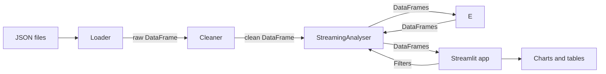

# Spotify Streaming History Analyser
 
Upload your Spotify streaming history and explore your listening habits. Built with Python, Pandas and Streamlit.

## Aims of this repository

At the time of working on this project I am a first year computer science student. I want to improve my documentation and planning skills so that I can be more effective at working with and understanding different stacks, as well as being able to work effectively in a team. The focus of this project is to have thorough and professional documentation and project structure just as much as it is to have a working solution. Any feedback on how to improve is appreciated. 

## Language and key information

Language: **Python 3.14**
Development environment: **VS Code**
Key libraries: **Pandas** for data analysis and **Streamlit** for frontend
 
## Features - Subject to change if I come up with more ideas
 
- Upload Spotify streaming history JSON file(s)
- Filter by date range 
- Top artists and tracks
- Listening patterns by week/month for each artist/song
  
## Privacy
 
Your listening history is personal, so here is exactly how it is handled:
 
- **Running locally (recommended):** Everything is processed on your own machine. Nothing leaves your computer.
- **Using a hosted version:** Your files are sent to the host's server and held in memory for the duration of your session only. This app does not write your data to disk or log it. Data is scoped to your session using Streamlit's `session_state` and is discarded when the session ends.
- **This repository contains no real listening data.**
  
## Getting your data from Spotify
 
1. Go to your Spotify account's **Privacy settings** page.
2. Under **Download your data**, request **Account data**.
3. Spotify emails you a link, which can take up to 30 days to arrive.
4. Unzip the download. You will find file(s) named `Streaming_History_music_0.json` (or very similar). This is the file(s) you upload.
 
## Installation
 
Requires Python 3.11 or newer.
 
```bash
git clone https://github.com/OliverJCox/Spotify_Data_Analyser.git
cd Spotify_Data_Analyser
python -m venv .venv
source .venv/bin/activate        # Windows: .venv\Scripts\activate
pip install -r requirements.txt
```
 
## Usage
 
```bash
streamlit run app.py
```
 
Open the URL shown in the terminal if it doesn't open automatically (usually `http://localhost:8501`), then upload your JSON files using the file uploader.
 
## Architecture
 
The backend knows nothing about the UI, and the frontend contains no analysis logic.
 

 
| Layer | Responsibility |
|---|---|
| **Loader** (`src/loader.py`) | Reads JSON files and validates the export format |
| **Cleaner** (`src/cleaning.py`) | Normalises raw data into a consistent DataFrame schema |
| **Analysis** (`src/analysis/`) | Pure functions: DataFrame in, DataFrame out |
| **Facade** (`src/analyser.py`) | `StreamingAnalyser`: the single object the frontend uses. Passes filters and delegates to analysis functions |
| **Frontend** (`app.py`) | Display only: widgets, tables and Matplotlib charts ect... |
 
### Data
 
After cleaning, every analysis function can rely on a DataFrame with these columns and no nulls:
 
| Column | Type | Description |
|---|---|---|
| `ended_at` | `datetime64[ns, UTC]` | When the stream ended |
| `track` | `str` | Track name |
| `artist` | `str` | Primary artist |
| `minutes` | `float` | Time played, in milliseconds |
 
### Key design decisions
 
- **Backend returns data, not figures.** The backend never imports Streamlit or Matplotlib, so the charting library can change without touching the logic.
- **`session_state` over `cache_data`.** Cached data in Streamlit is shared across users on a server. `session_state` keeps each user's data scoped to their own session.
- **Filters are arguments, not hidden states.** A frozen `Filters` (immutable) dataclass is passed into analyser methods on each call, which keeps behaviour predictable and easily testable.

### ADR's (Architectural decision records)

**ADR's can be found in ./docs/decisions/**
 
## Project structure
 
```
.
|-- app.py                  # Streamlit entry point (display only)
|-- src/
|   |-- loader.py           # JSON -> raw DataFrame
|   |-- cleaner.py          # Normalisation
|   |-- analysis/           # Pure analysis functions
|   |-- filters.py          # Filters and resulting dataclasses
|   |-- analyser.py         # StreamingAnalyser facade
|-- docs/
|   |-- decisions/          # Architecture Decision Records
|-- tests/                  # Contains all tests for modules
|-- requirements.txt
|-- README.md
```
 
## Known limitations
 
- Extended streaming history format is not supported.
- The 'endtime' data field is only accurate to the minute.


